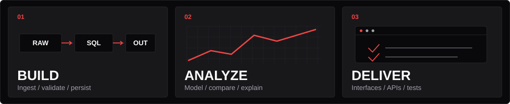
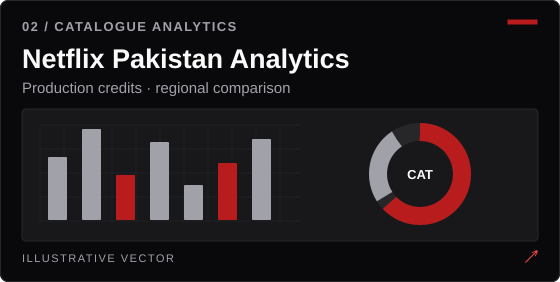
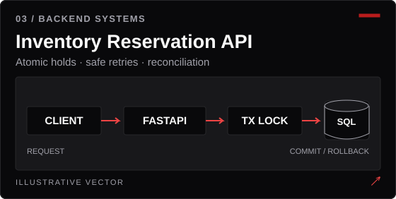
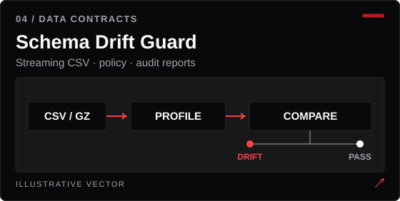
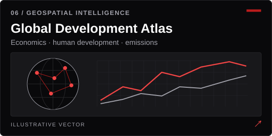
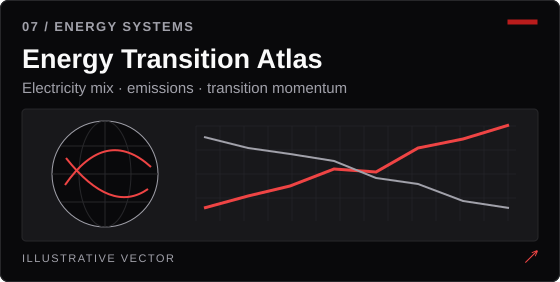
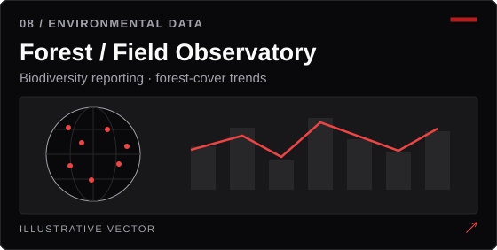
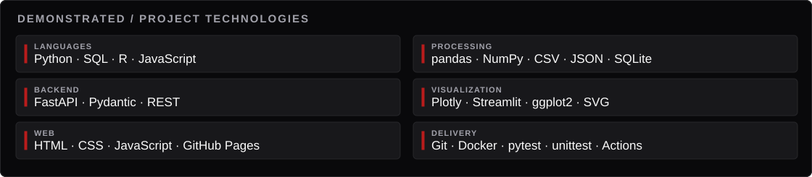
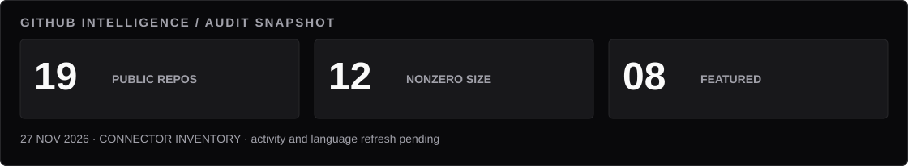

**Data Engineering · Analytics &amp; BI · Backend Systems**

Building reproducible data products, interactive analytical applications and reliable software.

[Live dashboards](#live-dashboards) · [Engineering](#featured-engineering) · [Science &amp; geography](#scientific--geospatial) · [Stack](#technology-stack) · [Activity](#github-intelligence)

## Live dashboards

<table>
<tr>
<td width="50%" valign="top"> <b><a href="https://github.com/nazirreally/nvda-insights-studio">NVDA Insights Studio</a></b> Historical OHLC, moving averages, volatility, drawdown and browser-side CSV import.  <code>JavaScript</code> <code>HTML/CSS</code> <code>SVG</code>  <a href="https://nazirreally.github.io/nvda-insights-studio/"><b>Open dashboard ↗</b></a> · <a href="https://github.com/nazirreally/nvda-insights-studio">Source</a></td>
<td width="50%" valign="top"> <b><a href="https://github.com/nazirreally/netflix-pakistan-plotly">Netflix Pakistan Analytics</a></b> Eight interactive Plotly charts, historical catalogue exploration and South Asian comparisons.  <code>Python</code> <code>Plotly</code> <code>Streamlit</code>  <a href="https://nazirreally.github.io/netflix-pakistan-plotly/"><b>Open dashboard ↗</b></a> · <a href="https://github.com/nazirreally/netflix-pakistan-plotly">Source</a></td>
</tr>
</table>

Documented GitHub Pages deployments. Historical datasets, not live feeds. Netflix measures production-country credits, not regional viewership or availability. All project cards are conceptual illustrations, not screenshots or measured charts.

## Featured engineering

<table>
<tr>
<td width="50%" valign="top"> <b><a href="https://github.com/nazirreally/inventory-reservation-api">Inventory Reservation API</a></b> Concurrency-safe stock holds, idempotent retries, expiry, cart availability and atomic batch reconciliation.  <code>FastAPI</code> <code>SQLite</code> <code>Docker</code> <code>pytest</code>  </td>
<td width="50%" valign="top"> <b><a href="https://github.com/nazirreally/schema-drift-guard">Schema Drift Guard</a></b> Streaming CSV/gzip profiling, versioned contracts, policy-based drift detection, HTML and JSON audit reports.  <code>Python</code> <code>CLI</code> <code>JSON</code> <code>unittest</code>  </td>
</tr>
<tr>
<td width="50%" valign="top"> <b><a href="https://github.com/nazirreally/cohort-retention-lab">Cohort Retention Lab</a></b> Maturity-aware and weighted retention, cohort revenue and observed revenue per original customer; synthetic or imported events.  <code>Python</code> <code>pandas</code> <code>Streamlit</code> <code>Plotly</code>  </td>
<td width="50%" valign="top"><b>Engineering principles</b>  Reproducible setup · explicit data contracts · transactional correctness · analytical transparency · automated regression tests.  See each repository for implementation details and current verification status.</td>
</tr>
</table>

## Scientific &amp; geospatial

<table>
<tr>
<td width="50%" valign="top"> <b><a href="https://github.com/nazirreally/global-development-atlas">Global Development Atlas</a></b> World Bank and OWID country-year indicators, interactive maps, trajectories, relationships and coverage audits.  <code>Python</code> <code>R</code> <code>Streamlit</code></td>
<td width="50%" valign="top"> <b><a href="https://github.com/nazirreally/energy-transition-atlas">Energy Transition Atlas</a></b> Electricity mix, emissions and economic indicators, consecutive-year transition momentum and geographic comparisons.  <code>Python</code> <code>Streamlit</code> <code>Plotly</code></td>
</tr>
<tr>
<td width="50%" valign="top"> <b><a href="https://github.com/nazirreally/biodiversity-climate-observatory">Biodiversity Climate Observatory</a></b> GBIF reporting-effort aggregates, World Bank forest-cover indicators and South Asian forest analysis in R.  <code>Python</code> <code>R</code> <code>Streamlit</code></td>
<td width="50%" valign="top"><b>Methodological transparency</b>  Published source projects, not claims of production deployments. Coverage, live ingestion, browser QA and CI limitations are documented in each project. Reporting effort is not a species population estimate; correlation is not causation.</td>
</tr>
</table>

## Technology stack

**Learning focus:** advanced orchestration, distributed processing, cloud platforms, monitoring and business intelligence.

## GitHub intelligence

[Actual contribution calendar](https://github.com/nazirreally#js-contribution-activity) · [Public repositories](https://github.com/nazirreally?tab=repositories)

Public data only. Language shares, when available, measure reported source bytes rather than skill. Calendar levels represent GitHub's published contribution intensity. See the refresh script and workflow for scope and limitations.

## Engineering approach

Repeatable setup, documented provenance, explicit assumptions, validation at data boundaries and automated tests. Historical and synthetic demonstration data are distinguished from live production data.

**Coursework:** [IBM Data Analyst Course](https://github.com/nazirreally/IBM-Data-Analyst-Course) — separate from standalone projects.

---

[Explore all repositories](https://github.com/nazirreally?tab=repositories) · [GitHub profile](https://github.com/nazirreally)

DATA PRODUCTS / ANALYTICAL THINKING / RELIABLE ENGINEERING

