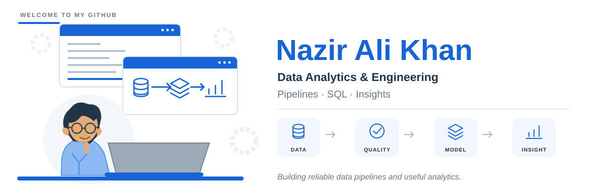
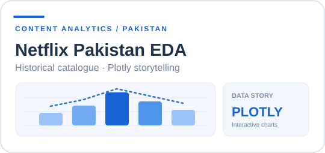

  

  

  
  

---

## 👋 About Me

I'm **Nazir Ali Khan**, with a background in Computer Science from **NED University**. I'm building a practical portfolio for **Data Analyst**, **BI / Analytics**, and **Data Engineer** opportunities.

My work covers two connected disciplines:
- **📊 Data Analytics:** exploratory analysis, cohort retention, time-series metrics, interactive dashboards, and clear interpretation of data.
- **🏗️ Data Engineering:** ingestion, validation, transformation, incremental loads, data contracts, reproducibility, and automated testing.

Projects below represent hands-on portfolio work; they are **not claims of prior professional employment** in either role.

---

## 🏗️ Data Engineering Projects

| Project | What it demonstrates | Tools |
| :--- | :--- | :--- |
| **[Rideshare Lakehouse](https://github.com/nazirreally/rideshare-lakehouse)** | An incremental rideshare lakehouse with Bronze/Silver data, upserts, quarantine, dbt models, and reconciliation | PySpark · Delta Lake · dbt · Docker |
| **[Schema Drift Guard](https://github.com/nazirreally/schema-drift-guard)** | CSV data contracts, versioned schema baselines, drift detection, policy checks, and CI-friendly reports | Python · CLI · unittest · GitHub Actions |
| **[Data Engineering Lab](https://github.com/nazirreally/data-engineering-lab)** | Batch ETL, record validation, rejection handling, idempotent fact/dimension loading, and reporting queries | Python · SQL · SQLite |

  

Ingest → Validate → Transform → Model → Test → Analyze

> **Data note:** Rideshare Lakehouse uses deterministic synthetic ride events to make the pipeline reproducible and avoid exposing personal records.

---

## 📊 Data Analytics & BI Projects

  
  

| Project | Analytical focus | Tools |
| :--- | :--- | :--- |
| **[Cohort Retention Lab](https://github.com/nazirreally/cohort-retention-lab)** | Customer retention by cohort, cohort maturity, weighted retention, revenue, and ARPU | Python · pandas · NumPy · Streamlit · Plotly |
| **[Netflix Pakistan · Plotly](https://github.com/nazirreally/netflix-pakistan-plotly)** | Exploratory analysis of Pakistan-linked production credits in a historical Netflix catalogue; includes comparative visuals and findings | Python · pandas · Plotly · Streamlit |
| **[NVDA Insights Studio](https://github.com/nazirreally/nvda-insights-studio)** | Historical NVIDIA stock-price trends, returns, moving averages, volatility, drawdown, and CSV exploration | JavaScript · HTML/CSS · SVG |

> **Interpretation matters:** The Netflix analysis concerns production-country credits, **not Pakistani viewership**. NVDA Insights Studio is based on historical market data and is **not a live trading or forecasting service**.

---

## 🛠️ Technical Skills Evidenced by Projects

| Data Analytics | Data Engineering | Quality & Delivery |
| :--- | :--- | :--- |
| SQL · pandas · NumPy | Python · PySpark · Delta Lake | pytest · unittest |
| EDA · Cohort analysis | ETL/ELT · dbt modeling | GitHub Actions · Git |
| Plotly · Streamlit | Data validation · Incremental processing | Docker · Data contracts |
| Metrics · Data visualization | Relational modeling · CSV/JSON ingestion | Reproducible local runs |

**Currently developing further:** Power BI and DAX, orchestration, cloud data services, and production monitoring. These are areas of growth rather than claims of workplace proficiency.

---

## 📁 Additional Work

- **[Inventory Reservation API](https://github.com/nazirreally/inventory-reservation-api)** — supporting backend project involving atomic database transactions, idempotent requests, and stock reconciliation.
- **[IBM Data Analyst Course](https://github.com/nazirreally/IBM-Data-Analyst-Course)** — coursework repository, separate from the independent portfolio projects above.

---

## 🎯 Portfolio Direction

My focus is on **reliable data pipelines and analytical outputs that can be explained, tested, and reproduced**. The next priorities are deeper SQL analysis, Power BI dashboards, end-to-end orchestration, and more rigorous validation of the existing projects.

  <a href="https://github.com/nazirreally?tab=repositories">View all repositories</a>

Build thoughtfully · Validate carefully · Communicate clearly

