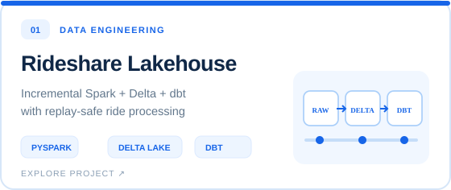
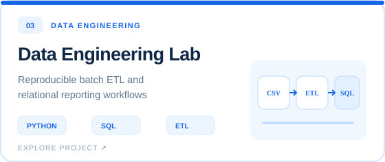
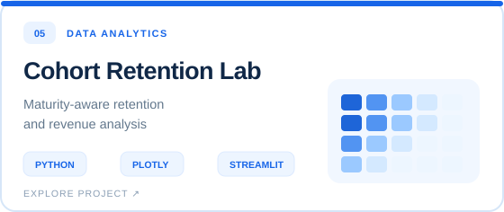
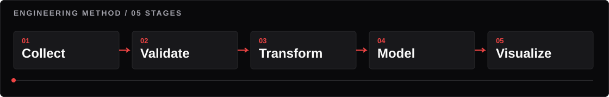

 

 

### About this portfolio

I’m **Nazir Ali Khan**, with a Computer Science background from **NED University**, building practical projects in **data engineering** and **data analytics / BI**. My work focuses on reliable ingestion, data validation, reproducible transformations, interpretable metrics, and usable analytics interfaces.

The repositories below show **implemented portfolio projects and ongoing learning**, not claims of professional employment in these roles.

<table>
<tr>
<td width="33%" valign="top"><b>🔷 Build</b> ETL, lakehouse design, structured data models and testable pipelines.</td>
<td width="33%" valign="top"><b>🔍 Validate</b> Schema contracts, replay behavior, data quality and automated testing.</td>
<td width="33%" valign="top"><b>📊 Explain</b> Dashboards, time-series analysis, cohort metrics and clear storytelling.</td>
</tr>
</table>

---

## 01 / Data Engineering

Reliable data movement, quality checks and analytical models.

**Featured:** [Rideshare Lakehouse](https://github.com/nazirreally/rideshare-lakehouse) implements a Docker-based **local** Spark + Delta Lake + dbt pipeline using synthetic trips, replay-safe updates, analytical marts and test workflows.

**Also explore:** [Schema Drift Guard](https://github.com/nazirreally/schema-drift-guard), a dependency-free CSV schema contract CLI, and [Data Engineering Lab](https://github.com/nazirreally/data-engineering-lab), a Python + SQLite batch ETL learning repository.

---

## 02 / Data Analytics

From raw records to interactive reports and interpretable business metrics.

**Dashboards:** [NVDA Insights Studio](https://github.com/nazirreally/nvda-insights-studio) ([**Live demo ↗**](https://nazirreally.github.io/nvda-insights-studio/)) explores imported and bundled historical stock prices in the browser. [Cohort Retention Lab](https://github.com/nazirreally/cohort-retention-lab) reports maturity-aware retention and cohort revenue using synthetic or imported events.

**Data storytelling:** [Netflix Pakistan](https://github.com/nazirreally/netflix-pakistan-plotly) analyzes Pakistan-linked **production credits** within a historical Netflix dataset; it does not measure regional viewership or current streaming availability.

---

## 03 / Technology Stack

**Hands-on project technologies**

**Currently developing:** Power BI and DAX, data orchestration, cloud data services, and monitoring. These are learning goals, not claims of professional proficiency.

**Additional work:** [Inventory Reservation API](https://github.com/nazirreally/inventory-reservation-api) explores transactional API correctness with FastAPI, SQLite and concurrency tests. The [IBM Data Analyst Course](https://github.com/nazirreally/IBM-Data-Analyst-Course) is coursework, separate from the projects above.

---

## How I approach a data project

I prioritize repeatable setup, explicit assumptions, automated tests, clear data provenance, and documentation that distinguishes **historical or synthetic demo data from live production data**.

---

### Explore the work

Reliable pipelines · Thoughtful analysis · Continuous improvement

