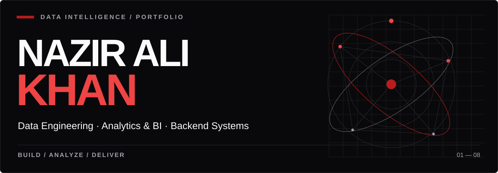
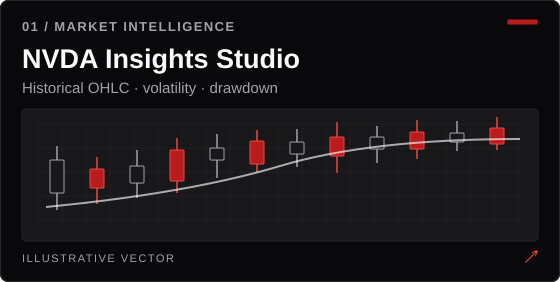

**Data Engineering · Analytics & BI · Backend Systems**

Building reproducible data products, interactive analytical applications and reliable software.

[Explore projects](#selected-projects) &nbsp;·&nbsp; [Live dashboards](#live-dashboards) &nbsp;·&nbsp; [Technology stack](#technology-stack) &nbsp;·&nbsp; [All repositories](https://github.com/nazirreally?tab=repositories)

---

## About

I’m **Nazir Ali Khan**, building a portfolio at the intersection of data engineering, business analytics and software engineering. I focus on turning raw data into reliable models, useful interfaces and reproducible analytical results.

<table>
<tr>
<td width="33%" valign="top"><b>01 / Build</b> Data ingestion, validation, persistence and repeatable processing.</td>
<td width="33%" valign="top"><b>02 / Analyze</b> Business metrics, scientific indicators, geospatial and time-series exploration.</td>
<td width="33%" valign="top"><b>03 / Deliver</b> Interactive dashboards, transactional APIs, automated tests and documentation.</td>
</tr>
</table>

## Live dashboards

Two browser-based projects can be explored without installing software.

<table>
<tr>
<td width="50%" valign="top">

 <b>NVDA Insights Studio</b> 
Historical price exploration, OHLC charts, moving averages, volatility, drawdown and browser-side CSV import.
  
<code>JavaScript</code> <code>HTML/CSS</code> <code>SVG</code>
  
<a href="https://nazirreally.github.io/nvda-insights-studio/"><b>Open dashboard ↗</b></a> &nbsp;·&nbsp; <a href="https://github.com/nazirreally/nvda-insights-studio">Source</a>
</td>
<td width="50%" valign="top">

 <b>Netflix Pakistan Analytics</b> 
Interactive catalogue analysis with eight Plotly charts, regional comparisons and searchable historical records.
  
<code>Python</code> <code>Plotly</code> <code>Streamlit</code>
  
<a href="https://nazirreally.github.io/netflix-pakistan-plotly/"><b>Open dashboard ↗</b></a> &nbsp;·&nbsp; <a href="https://github.com/nazirreally/netflix-pakistan-plotly">Source</a>
</td>
</tr>
</table>

Both demos are documented GitHub Pages deployments using historical data, not live feeds. Netflix analysis concerns production-country credits, not regional viewership or availability.

---

## Selected projects

### 01 / Data Engineering & Backend

<table>
<tr>
<td width="50%" valign="top">
<h3><a href="https://github.com/nazirreally/inventory-reservation-api">Inventory Reservation API</a></h3>
Transactional backend engineering  
Concurrency-safe stock holds, idempotent retries, expiration, cart availability and atomic batch reconciliation.
  
<code>FastAPI</code> <code>SQLite</code> <code>Docker</code> <code>Pytest</code>
  

</td>
<td width="50%" valign="top">
<h3><a href="https://github.com/nazirreally/schema-drift-guard">Schema Drift Guard</a></h3>
Data quality & developer tooling  
Streaming CSV and gzip profiling, versioned schema contracts, policy-based drift detection, HTML and JSON audit reports.
  
<code>Python</code> <code>CLI</code> <code>JSON</code> <code>unittest</code>
  

</td>
</tr>
</table>

### 02 / Business Analytics

| Project | Analytical focus | Technologies |
| :--- | :--- | :--- |
| [**Cohort Retention Lab**](https://github.com/nazirreally/cohort-retention-lab) | Maturity-aware retention, weighted cohort curves, revenue and observed revenue per original customer | Python, pandas, Streamlit, Plotly |
| [**NVDA Insights Studio**](https://github.com/nazirreally/nvda-insights-studio) | Historical financial time series, risk metrics, data quality and exportable reports | JavaScript, SVG, CSV |
| [**Netflix Pakistan Analytics**](https://github.com/nazirreally/netflix-pakistan-plotly) | Historical catalogue EDA, production credits and South Asian comparisons | Python, Plotly, Jupyter, Streamlit |

### 03 / Scientific & Geospatial Intelligence

<table>
<tr>
<td width="33%" valign="top">
<h3><a href="https://github.com/nazirreally/global-development-atlas">Global Development Atlas</a></h3>
Economics · Human development  
World Bank and OWID country-year indicators, interactive maps, country trajectories, relationships and coverage audits.
  <code>Python</code> <code>Streamlit</code> <code>R</code>
</td>
<td width="33%" valign="top">
<h3><a href="https://github.com/nazirreally/energy-transition-atlas">Energy Transition Atlas</a></h3>
Energy · Climate  
Electricity mix, emissions and economic indicators, with consecutive-year transition momentum and interactive geographic comparisons.
  <code>Python</code> <code>Streamlit</code> <code>Plotly</code>
</td>
<td width="33%" valign="top">
<h3><a href="https://github.com/nazirreally/biodiversity-climate-observatory">Forest / Field Observatory</a></h3>
Biodiversity · Environment  
GBIF reporting-effort aggregates and World Bank forest-cover indicators, including a South Asian forest analysis in R.
  <code>Python</code> <code>R</code> <code>Streamlit</code>
</td>
</tr>
</table>

Scientific applications are published source projects. Consult individual READMEs for live-ingestion, CI, data-coverage and browser-verification limitations.

---

## Technology stack

| Layer | Technologies used in portfolio projects |
| :--- | :--- |
| Languages & querying | Python, SQL, R, JavaScript |
| Data processing | pandas, NumPy, CSV, JSON, SQLite |
| APIs & services | FastAPI, Pydantic, REST |
| Visualization | Plotly, Streamlit, ggplot2, SVG |
| Web interfaces | HTML, CSS, JavaScript, GitHub Pages |
| Engineering & delivery | Git, Docker, pytest, unittest, GitHub Actions |

**Learning focus:** advanced orchestration, distributed processing, cloud data platforms, monitoring and business intelligence.

## Engineering approach

Repeatable setup, documented source provenance, explicit assumptions, validation at data boundaries and automated tests. I distinguish historical and synthetic demonstration data from live production data, and do not present correlation as causation.

## Coursework

[IBM Data Analyst Course](https://github.com/nazirreally/IBM-Data-Analyst-Course) — learning material, separate from the featured standalone projects.

---

**Explore the code. Review the methodology. Run the projects.**

Data products · Analytical thinking · Reliable engineering

