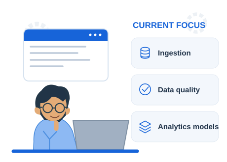
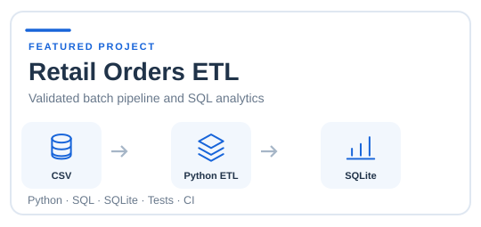
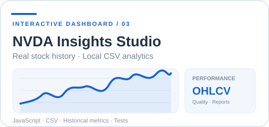
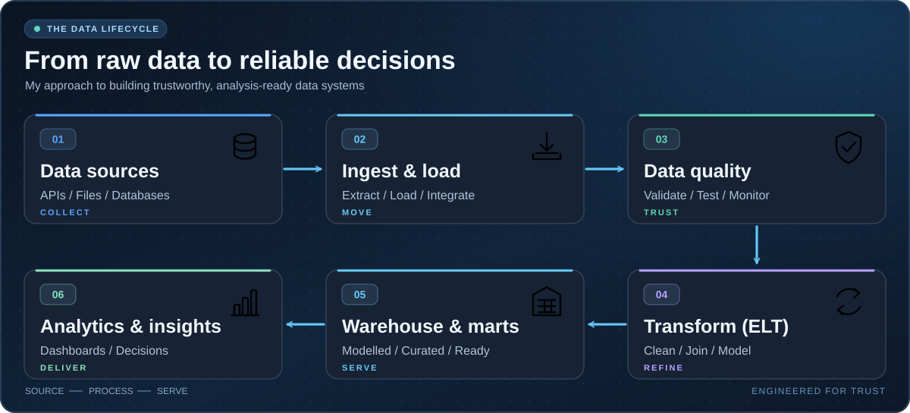

  

  

  
  
  

---

<table>
<tr>
<td valign="top" width="59%">
  <h3>👨‍💻 About me</h3>
  
I'm <strong>Nazir Ali Khan</strong>, a software engineer based in <strong>Karachi, Pakistan</strong>, with a growing focus on <strong>data engineering</strong> and <strong>data analytics</strong>.

  <ul>
    <li>🔧 Building reproducible data pipelines with Python and SQL.</li>
    <li>🧪 Interested in automated testing, data quality and dependable systems.</li>
    <li>📊 Turning raw data into useful, analysis-ready datasets.</li>
    <li>🌱 Learning modern tools for orchestration, transformations and cloud data workflows.</li>
    <li>🎯 Developing a practical portfolio for <strong>Data Engineer</strong> and <strong>Data Analyst</strong> roles.</li>
    <li>🎓 Computer Science graduate studies at <strong>NED University</strong>.</li>
  </ul>
</td>
<td valign="middle" width="41%">
  
</td>
</tr>
</table>

---

## ⚡ Languages, Tools & Technologies

<b>Core tools and hands-on project work</b>

  

  
  
  
  

<b>Exploring / on my learning roadmap</b>

  
  
  
  
  
  
  

> The tools above are split between hands-on work and my learning roadmap; I don't claim professional proficiency in every listed technology.

---

## 🚀 Featured Work

  
  

### 🏗️ [Retail Orders ETL · Data Engineering Lab](https://github.com/nazirreally/data-engineering-lab)

A working **Python + SQLite batch ETL** that reads retail orders from CSV, validates records, writes rejected rows to an audit file, and loads an analytics-friendly relational model.

`Python` · `SQL` · `SQLite` · `unittest` · `GitHub Actions`

**Engineering details:** idempotent upserts, data-quality checks, dimension/fact tables, revenue reconciliation and automated tests.

### 📈 [NVDA Insights Studio · Interactive Analytics Dashboard](https://github.com/nazirreally/data-engineering-lab/tree/main/projects/03-nvda-insights-studio)

A working **NVIDIA historical-price analytics dashboard** with CSV import, trend charts, period filters, volatility and drawdown metrics, data-quality checks and downloadable reports. The included historical sample uses a separately attributed source; you can import the [Kaggle NVDA dataset](https://www.kaggle.com/datasets/caesarmario/nvidia-stock-historical-price) directly in the interface.

`JavaScript` · `HTML/CSS` · `SVG` · `CSV Analytics` · `Node Tests`

**Also building:** [HTTP Log Analytics & Monitoring Engine](https://github.com/nazirreally/data-engineering-lab/tree/main/projects/02-log-analytics).

---

## 🏗️ My Data Engineering Approach

  

Collect → Ingest → Validate → Transform → Serve → Analyze

---

## 🧭 What I'm Building Next

| Project direction | Focus |
| :--- | :--- |
| 🐘 **PostgreSQL + Docker ETL** | Production-style database setup and reliable batch ingestion |
| 🔁 **Airflow-orchestrated pipeline** | Scheduling, retries, monitoring and reproducible tasks |
| 🧪 **Data quality framework** | Validation rules, testing, rejected records and auditability |
| 📈 **Analytics dashboard** | SQL-based metrics, data storytelling and decision-ready visuals |
| ☁️ **Cloud data pipeline** | Managed storage, deployment and observability |

---

## 📊 GitHub Activity

  
  

  

---

<b>Build thoughtfully · Test thoroughly · Learn continuously</b>

Thanks for visiting — explore my <a href="https://github.com/nazirreally?tab=repositories">repositories</a> to follow the work.

